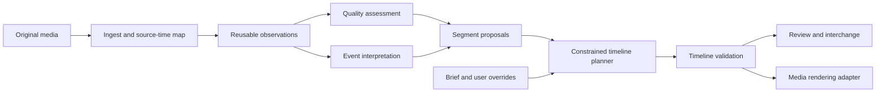

# Architecture

Status: accepted initial direction; most components below are planned. Current code includes
source-time values, ingest, decoded maps, sample-coordinate mapping, versioned project registries,
validated artifact loaders and preserved stage attempts/cache receipts.
Manual single-source timelines and decoded-verified MOV previews are implemented; see `previews.md`.
Versioned focus/exposure observations and a bounded grayscale adapter are implemented; see `quality.md`
and ADR 0005. Bounded background translation candidates and source-time path residuals share the
verified analysis preparation/decoder; see `motion.md` and ADR 0006. Explicit temporal interpretation policies now produce review candidates with preserved unknown coverage;
see `interpretation.md` and ADR 0007. Immutable explicit editing decisions, restoration and bound single-source preview plans are implemented;
see `decisions.md` and ADR 0008. An exact-duration evaluation harness preserves rights/labels/splits and separates synthetic/camera
evidence; see `quality-evaluation.md` and ADR 0009. Camera validation and calibrated automatic
exclusion remain pending. An explicitly single-AI-reviewed public sample pilot is documented in
`labeled-pilot.md` and ADR 0010; independent human validation remains open. See the roadmap.

## Product boundary

Input: multiple camera originals, an optional editing brief and optional music/environmental audio.
Output: an editable rough-cut plan, reasons and alternatives, a preview and eventually a final render.
First domain: dialogue-free process/product footage, chronological ordering, human review.

## Flow and dependency direction



CLI/UI call application use cases. Use cases orchestrate domain functions and concrete adapters.
Adapters depend on domain contracts; domain imports no adapters. Avoid an abstract base class
for every function. Introduce structural protocols only where an implemented boundary needs them.

## Modules and responsibilities

| Module | Owns | Must not own |
|---|---|---|
| `domain/` | Exact time, ranges, eventual events/decisions/timeline invariants | Files, models, FFmpeg, UI |
| `application/` (M1) | Use cases, stage execution, cancellation, artifacts | Quality/model algorithms |
| `adapters/media/` (M1) | ffprobe parsing, decode, frame PTS map, render | Editorial intent |
| `quality/` (M2) | Focus, shake, exposure observations and interpretations | Final irreversible exclusions |
| `semantics/` (M3) | Observed events, intent matching, evidence | Executable commands |
| `selection/` (M3) | Candidate windows, completeness and alternative groups | Pixel decoding |
| `assembly/` (M4) | Selection, ordering, duration and coverage constraints | Model-specific prompts |
| `adapters/models/` (M3) | One optional local backend initially | Shared source-time truth |
| `adapters/export/` (M4) | OTIO and later validated interchange adapters | Replanning cuts |
| `review/` (M4) | Evidence display and explicit user overrides | Separate editing algorithm |

Create these modules as working slices arrive; empty directory trees are not deliverables.

## Four distinct artifact classes

1. **Observation:** measured sharpness/flow/exposure/embeddings with source ranges and method version.
2. **Interpretation:** event identity, focus-failure suspicion, role suggestions; evidence + uncertainty.
3. **Decision:** chosen/skipped ranges and ordering given a brief, policy version and user overrides.
4. **Execution:** validated timeline, rendered artifact and verification report.

An interpretation can be wrong without corrupting the media clock. A policy change can reuse
observations. A render uses the saved timeline, never free-form model prose.

## Media time

Source coordinates: asset ID + stream index + integer PTS + rational time base, `[in, out)`.
PTS may start negative or nonzero. A range endpoint is a presentation boundary, not a packet DTS.
Ingest must construct decoded-frame boundaries including the final frame's presentation end;
missing or discontinuous timestamps require an explicit repair/unsupported result.

Timeline coordinates: a chosen rational output frame rate and integer output frame counts.
Audio coordinates: sample counts at an explicit sample rate. Conversion/rounding policies live in
one place. For VFR, source membership and proxy mapping use frame PTS; average FPS is metadata only.
`domain/time.py` validates arithmetic; `domain/frames.py` validates decoded frame membership for
ready maps. See `frame-maps.md` for conservative timing diagnostics and explicit proxy origins.

## Project storage and incremental execution

Planned workspace (outside the source tree, or under ignored `workspace/`):

```text
project.json                 # schema version, asset references, fingerprints
assets/                      # metadata and source/proxy PTS maps
observations/<stage-key>/    # reusable measurements
interpretations/<run-id>/    # model outputs and validated events
plans/<plan-id>/             # brief, overrides, timeline, reasons
renders/<render-id>/         # media + validation receipt
```

Do not copy originals by default. Fingerprints identify assets; full digest verification precedes
long-lived cache reuse, with an inexpensive metadata check for immediate changes. Cache keys include
source identity, extraction settings, code/model revisions and preprocessing. Never key solely on a
filename. User edits are small override records applied to a plan; preserve the previous plan.

Publish immutable artifacts without clobbering, and replace derived/current pointers atomically.
A stage records completed/failed/cancelled status;
partial output is not a cache hit. Limit concurrent work and stream frames instead of materializing
the entire source. Start with sequential orchestration and bounded subprocesses. Introduce SQLite
indexes or a worker process when measured project sizes or UI responsiveness justify them.

The concrete registry/scan-stage implementation and crash/concurrency limits are in `projects.md`
and ADR 0003. Registry snapshots and attempt artifacts are retained; only current/derived pointers
advance. Sources are rehashed before reuse, and stage outputs require matching terminal receipts,
checksums and domain-loader validation.

## Planning policy

Initial baseline: chronological candidates + duration budget + deduplication + mandatory events.
Next: alternative trim variants and role coverage. Optional constrained optimization follows a
measured weakness of the baseline; OR-Tools is a candidate, not a bootstrap dependency.

Hard constraints: valid source range, no forbidden overlaps, no excluded segment, preserved mandatory
events, explicit chronological dependencies. User overrides may intentionally include a suspect
quality region, with the conflict recorded. Soft objectives: relevance, completeness, variety,
transition continuity and target duration. If infeasible, report missing coverage/closest feasible
duration; never silently violate a hard constraint or cut through the required action.

The planner is deterministic for saved observations, interpretation outputs, policy and overrides,
including tie-breaking. Inference reproducibility is weaker: save responses, prompt/schema version,
model revision, preprocessing and backend, and report uncertainty instead of promising bitwise replay.

## Quality and model inference

Quality uses measured time-series features and genre policies. Low motion alone is not waiting.
Camera motion is estimated from background tracks; tracking failure yields unknown rather than
"good" or "bad". Subject-level focus needs adequate resolution. Fast events and high-frequency
shake require dense local reinspection; sparse global samples only propose where to look.

Models return structured proposals tied to allowed asset IDs and observed windows. Schema validation,
range checks and evidence checks happen before planning. Model-provided confidence is not a calibrated
probability. A model cannot introduce source files, commands, URLs to execute or out-of-bounds cuts.

## Execution, privacy and failure behavior

FFmpeg invocation uses argument lists and no shell interpolation. Resolve destination paths and
reject source overwrite. Bound runtime, memory and decoded work where practical; handle cancellation
and cleanup. Validate rendered duration and audio/video alignment against the timeline.

No network at import or basic CLI invocation. Model downloads and remote providers require explicit
selection; future remote inference must display what media is sent. Reports redact secrets and offer
path redaction before sharing. Source footage and user correction data are never uploaded by default.

## Deliberate tradeoffs

- Python and FFmpeg give an accessible pipeline but may need optimized decode paths later.
- JSON artifacts are inspectable but inefficient for very large projects; defer a storage service.
- Chronological assembly is limited creatively but protects process order in the first use case.
- A reviewable first cut accepts uncertainty; full unattended editing needs stronger evidence.
- Optional models complicate capability reporting but keep installation and licensing manageable.

## Revisit triggers

Separate inference into a process when GPU lifetime/isolation or UI responsiveness requires it.
Add a database when artifact indexing dominates measured latency. Add a remote job system only after
multi-machine execution is a concrete requirement. Change planning algorithms based on labeled
coverage/edit-time results, not model novelty.
